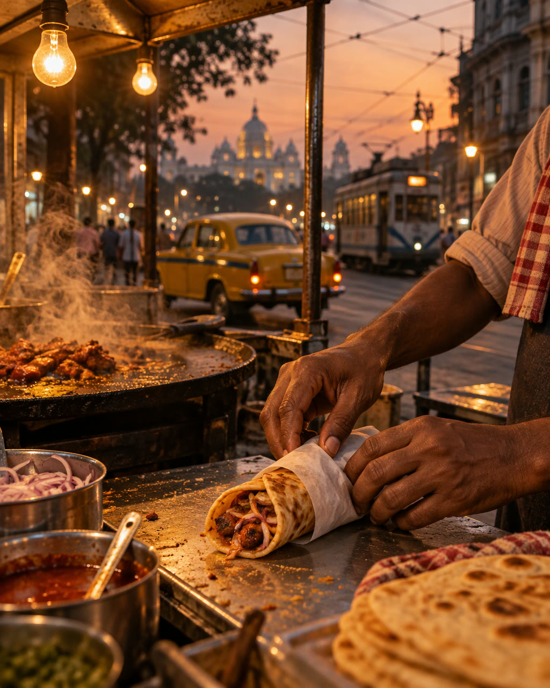

# Roll Call — A Kolkata Street-Food Atlas

**Ten legendary stops. A thousand unforgettable flavours. One city worth exploring.**



Roll Call is an editorial field guide to Kolkata's street food: ten stops, what to order at each, when to turn up, and where to stand while you eat. It pairs an illustrated city map with food photography, a two-theme design and a whole-atlas field guide on one page.

## Live

- Vercel: https://roll-call-alpha-pink.vercel.app
- GitHub Pages: https://ifazulhq.github.io/roll-call-kolkata/
- Source: https://github.com/ifazulhq/roll-call-kolkata

## The ten stops

| No. | Stop | What to order | Area | Price |
| --- | --- | --- | --- | --- |
| 01 | Nizam's | Chicken kathi roll | New Market | ₹80–160 |
| 02 | Dacres Lane | Fish fry + chicken stew | Esplanade | ₹70–150 |
| 03 | Anadi Cabin | Mughlai paratha | Esplanade | ₹90–140 |
| 04 | Paramount | Kesar sharbat | Esplanade | ₹40–80 |
| 05 | K.C. Das | Rosogolla | Esplanade | ₹30–80 |
| 06 | Zakaria Street | Chicken changezi | Burrabazar | ₹100–250 |
| 07 | Tiretta Bazaar | Chinese breakfast | Tiretta | ₹50–120 |
| 08 | Radhu Babu'r Telebhaja | Mochar chop + beguni | Maidan | ₹20–50 |
| 09 | Arsalan | Mutton biryani | Park Circus | ₹150–320 |
| 10 | Vivekananda Park Phuchka | Phuchka | Southern Avenue | ₹30–60 |

## Features

- Illustrated SVG map of Kolkata with ten numbered, keyboard-accessible pins.
- Live stop spotlight with what to order, price, best time and where to eat it.
- Ten editorial stop cards with a mix of feature, paired, full-bleed and closing layouts.
- Field-guide table with every stop's order, price, timing and map link.
- Light and dark themes with persisted preference and a system-theme fallback.
- Responsive layouts for desktop, laptop, tablet and phones down to 320 px.
- Scroll reveals, hero entrance motion and `prefers-reduced-motion` support.
- All copy held in one content model for easy editing.

## Tech

Vanilla HTML, CSS and JavaScript. No build step, framework or runtime dependencies. Fonts are loaded from Google Fonts: Fraunces, DM Sans and Space Mono. Photography is AI-generated for this project and optimized as local JPEGs.

## Project structure

```text
.
├── index.html      markup and map artwork
├── styles.css      design tokens, themes, layout and motion
├── app.js          rendering, map, spotlight, navigation and theme logic
├── content.js      all visible copy and the ten destination records
├── assets/         hero, stop and about photography
└── README.md
```

## Run locally

Serve the folder over HTTP so the assets and scripts load correctly:

```bash
python -m http.server 5175
```

Then open http://127.0.0.1:5175/. Any static file server works, for example `npx serve .`.

## Editing the guide

- Destination names, dishes, prices, timings, descriptions, photo paths and map coordinates live in `content.js`.
- UI labels, navigation, section copy, credits and footer text are in the same file.
- Theme colours and type tokens are at the top of `styles.css`; light and dark palettes are defined separately.
- Replace a photo by adding a new file to `assets/` and updating its `image` path in `content.js`.

## Deployment

The site is a static bundle with `index.html` at the repository root.

- **GitHub Pages:** deploy from the `main` branch at `/` (the live URL above).
- **Vercel:** the repository is connected to the `ifazulhq/roll-call` project. It builds as an "Other" framework with no build command and the output directory set to `.`, and every push to `main` ships to production.

## Notes

Prices are indicative and change with season, shop and appetite. Timings are guidance rather than guarantees. This is an independent guide, not an official page for any of the establishments.
